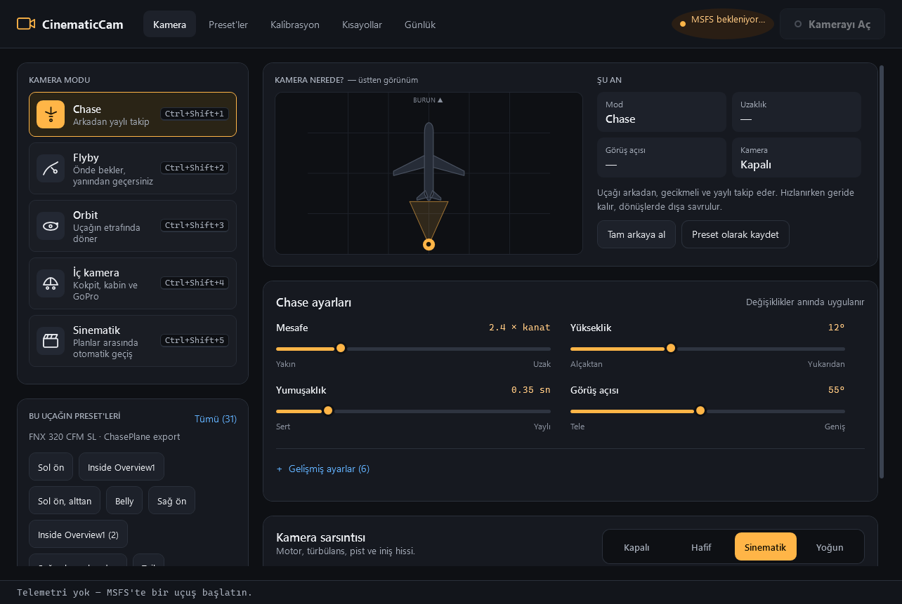
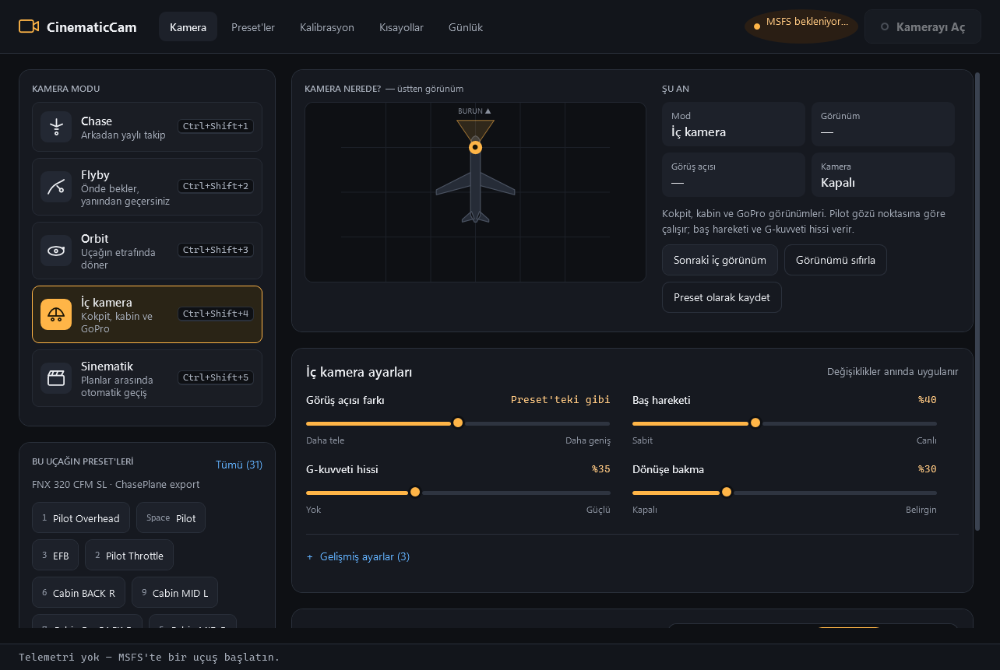
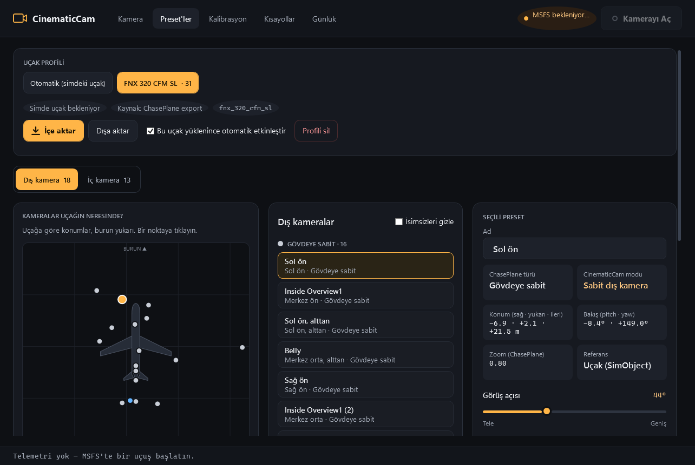
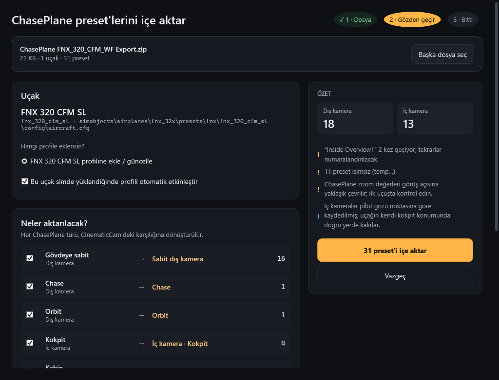
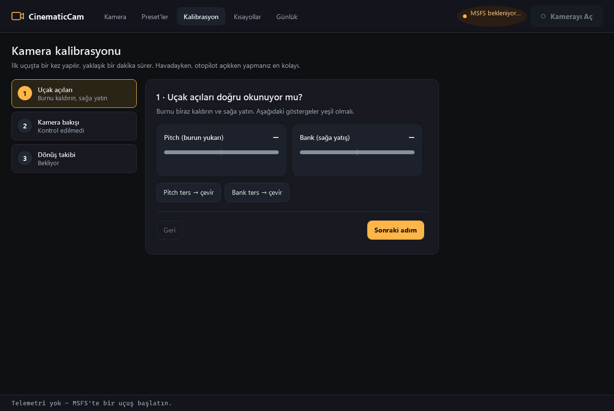
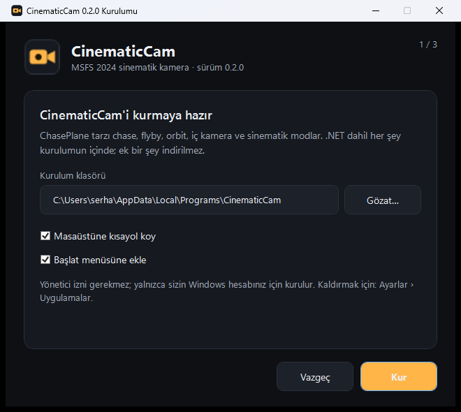

<p align="center">
  
</p>

<h1 align="center">CinematicCam</h1>

<p align="center">
  MSFS 2024 için ChasePlane tarzı sinematik kamera eklentisi<br>
  <a href="https://github.com/serhatgundogdu/MSFSCameraAddon/releases/latest"><b>⬇ Son sürümü indir</b></a>
</p>

<p align="center">
  
</p>

| İç kamera | Preset kütüphanesi | ChasePlane'den içe aktarma |
|---|---|---|
|  |  |  |

| Kalibrasyon sihirbazı | Kurulum |
|---|---|
|  |  |

## Hakkında

ChasePlane tarzı, harici bir masaüstü uygulaması. MSFS 2024 SDK'daki SimConnect **Camera API**
(`SimConnect_CameraAcquire` / `CameraSet` / `CameraRelease`) ile simin kamerasını devralır ve her görsel
karede yeniden konumlandırır.

## Özellikler

| Mod | Kısayol | Açıklama |
|---|---|---|
| **Chase** | `Ctrl+Shift+1` | Uçağı arkadan yaylı takip eder. Baş takibi gecikmeli, ivme kamerayı iter (G hissi), ufuk büyük ölçüde sabit kalır. |
| **Flyby** | `Ctrl+Shift+2` | Kamera rotanın önüne kurulur. Uçak yanından geçerken onu çevirir, uzaklaştıkça zoom yapar, sonra yeni nokta seçer. |
| **Orbit** | `Ctrl+Shift+3` | Uçak etrafında sabit hızla döner. |
| **İç kamera** | `Ctrl+Shift+4` | Kokpit, kabin ve GoPro görünümleri. Pilot gözü (Eyepoint) noktasına göre çalışır; baş hareketi, G-kuvveti, dönüşe bakma ve gövde titreşimi ekler. |
| **Sinematik** | `Ctrl+Shift+5` | Takip, yandan takip, flyby, orbit, uçağın sabit preset'leri ve (isteğe bağlı) kokpit/kabin planları arasında otomatik geçiş yapar. |

Bunlara ek olarak **sabit dış kamera** var: gövdeye bağlı bir preset (kuyruk, karın, kanat ucu…) uygulandığında
devreye giren moddur, ayrı bir mod kartı yoktur.

- **Uçak profilleri:** Preset'ler uçağa göre saklanır. Simde bir uçak yüklendiğinde profili otomatik etkinleşir
  (SimConnect `AircraftLoaded` ile gelen `aircraft.cfg` yoluna göre).
- **ChasePlane'den içe aktarma:** ChasePlane'in “Export” zip dosyası doğrudan içe aktarılır (aşağıya bakın).
- **Kamera sarsıntısı:** Motor, türbülans, pist, iniş darbesi ve elde kamera hissi. Tek tıkla Kapalı / Hafif / Sinematik / Yoğun seçilir.
- **Kalibrasyon sihirbazı:** Açıların işaretlerini canlı göstergelerle 3 adımda doğrular.
- **Sistem geneli kısayollar:** MSFS odaktayken de çalışır; *Kısayollar* sayfasında tıklayıp tuşlara basarak değiştirilir.

## ChasePlane preset'lerini içe aktarma

1. ChasePlane'de uçağınızın kameralarını dışa aktarın (ör. `ChasePlane FNX_320_CFM_WF Export.zip`).
2. CinematicCam'de **Preset'ler › İçe aktar**'a basın veya ana ekrandaki “ChasePlane export'u içe aktar” düğmesini kullanın.
3. Önizleme ekranında hangi türlerin aktarılacağını, isimsiz preset'lerin (`temp1…`) ne olacağını ve
   kısayolların alınıp alınmayacağını seçin.

| ChasePlane türü | CinematicCam karşılığı |
|---|---|
| `OUTSIDE_AIRFRAME` (gövdeye sabit) | Sabit dış kamera |
| `OUTSIDE_CHASE` | Chase (mesafe, yükseklik ve açı preset'ten hesaplanır) |
| `OUTSIDE_ORBIT` | Orbit |
| `ONBOARD_PIC` (kokpit) | İç kamera · Kokpit |
| `ONBOARD_CABIN` | İç kamera · Kabin |
| `ONBOARD_MOUNTED` (GoPro) | İç kamera · Sabit |

Notlar:
- İsimsiz preset'lere konuma göre ad verilebilir (ör. “Sol ön, yukarıdan”).
- ChasePlane bazı isimlerin içine görünmez kontrol karakterleri koyuyor; bunlar aktarılırken temizlenir.
- ChasePlane tuşları (1…0, −, =, Space) **yalın** olarak alınmaz; sistem genelinde yazmayı engelleyeceği için önlerine
  bir değiştirici eklenir (varsayılan `Alt+Shift`). Çakışanlar atlanıp listelenir.
- ChasePlane'in *zoom* değeri görüş açısına **yaklaşık** çevrilir (`FOV ≈ 100 − 70 × zoom`). Gerekirse preset ayrıntısından düzeltin.
- Profiller **Dışa aktar** ile `.json` olarak kaydedilip başka bir bilgisayara aynı düğmeyle geri yüklenebilir.

## Kurulum (kullanıcılar için)

`CinematicCam-Setup-<sürüm>.exe` dosyasını çalıştırın. Kurulum:

- **Hiçbir şey gerektirmez:** .NET 9 çalışma zamanı içine gömülüdür; sihirbazın kendisi Windows'ta hazır gelen .NET Framework 4.8 ile çalışır.
- **Yönetici izni istemez:** yalnızca sizin hesabınız için `%LOCALAPPDATA%\Programs\CinematicCam` klasörüne kurulur.
- Masaüstü ve Başlat menüsü kısayolu oluşturur, *Ayarlar › Uygulamalar* listesine eklenir.
- Güncellemede eski sürümün üzerine kurar; ayarlar, preset'ler ve kısayollar (`%APPDATA%\CinematicCam`) korunur.
- Kaldırıcı yalnızca kurulumun yazdığı dosyaları siler. Ayarları silmek isteğe bağlıdır.
- Sessiz kullanım: `CinematicCam-Setup-0.2.0.exe /S` (kurar veya günceller), `Uninstall.exe /S` (ayarları koruyarak kaldırır).

> Setup.exe imzasız olduğu için Windows SmartScreen ilk açılışta “Bilinmeyen yayımcı” uyarısı gösterebilir:
> *Ek bilgi › Yine de çalıştır*.

## Kurulum dosyasını üretme (geliştiriciler için)

```bash
powershell -ExecutionPolicy Bypass -File build-setup.ps1
```

Çıktı: `artifacts\CinematicCam-Setup-<sürüm>.exe`. Sürüm numarası `Directory.Build.props` dosyasındadır.
Betik, uygulamayı .NET çalışma zamanı dahil tek dosya olarak yayınlar (ilk seferde nuget.org'dan çalışma zamanı
paketlerini indirir), zip'ler ve `installer\Setup` sihirbazının sonuna ekler. Uygulama simgesi `assets\CinematicCam.ico`
dosyasıdır; `installer\make-icon.ps1` ile yeniden üretilebilir.

## Gereksinimler

- Windows 10/11 x64
- MSFS 2024
- Derlemek için: .NET 9 SDK, .NET Framework 4.8 hedef paketi ve MSFS 2024 SDK (`MSFS2024_SDK` ortam değişkeni tanımlı olmalı; `SimConnect.dll` buradan kopyalanır)

## Derleme ve çalıştırma

```bash
dotnet build -c Release
```

```bash
src/CinematicCam/bin/Release/net9.0-windows/win-x64/CinematicCam.exe
```

1. MSFS 2024'ü açın ve bir uçuş başlatın. Uygulama otomatik bağlanır (üst barda yeşil “MSFS 2024 bağlı”).
2. **Kamerayı Aç**'a basın veya `Ctrl+Shift+C`.
3. Sol taraftan mod seçin; ayarlar sadece seçili moda göre gösterilir, teknik olanlar “Gelişmiş ayarlar” altındadır.

> Simde *Seçenekler › Genel › Kamera* altında eklenti kameralarına izin verilmiş olmalıdır.
> Üst barda “eklenti kamerası simde kapalı” yazıyorsa bu ayarı kontrol edin.

## Varsayılan kısayollar

| Kısayol | İşlev |
|---|---|
| `Ctrl+Shift+C` | Kamerayı aç/kapa |
| `Ctrl+Shift+1…5` | Chase / Flyby / Orbit / İç kamera / Sinematik |
| `Ctrl+Shift+N` | Sonraki: flyby noktası, iç görünüm veya sinematik plan |
| `Ctrl+Shift+Ok tuşları` | Kamerayı döndür |
| `Ctrl+Shift+PageUp/PageDown` | Yaklaş / uzaklaş |
| `Ctrl+Shift+Home` | Döndürme ve zoom'u sıfırla |
| `Ctrl+Shift+S` | Sarsıntıyı aç/kapa |
| `Ctrl+Shift+F1…F9` | Kamera ayarı slotunu yükle |
| `Ctrl+Alt+Shift+F1…F9` | Kamera ayarlarını slota kaydet |
| `Alt+Shift+…` | ChasePlane'den aktarılan görünümler (ör. `Alt+Shift+6` = Cabin BACK R) |

> Önceki sürümün ayar dosyası açılışta otomatik güncellenir: slot kısayolları F tuşlarına taşınır,
> Sinematik `Ctrl+Shift+5` olur.

## İlk uçuşta kalibrasyon

SDK dokümantasyonu kamera açılarının işaret yönlerini (pitch/bank pozitif yönü) net belirtmiyor. **Kalibrasyon**
sayfasındaki 3 adımlı sihirbaz bunu doğrular:

1. **Uçak açıları:** Burnu kaldırıp sağa yatınca iki gösterge de yeşil olmalı; değilse “ters → çevir”.
2. **Kamera bakışı:** Chase modunda kamera uçağı hafifçe yukarıdan görmeli; gökyüzüne bakıyorsa “Hayır, ters”.
3. **Dönüş takibi:** Kamera yanlış yöne bakıyorsa yedek yön gönderme yöntemini seçin.

## Mimari

```
src/CinematicCam/
  Interop/SimConnectNative.cs     Native SimConnect.dll P/Invoke (managed DLL .NET Framework'e bağlı olduğu için kullanılmıyor)
  Sim/SimConnectClient.cs         Bağlantı, veri isteği (her görsel kare), kamera devralma, AircraftLoaded. Tek iş parçacığı.
  Sim/AircraftState.cs            Simvar'lar ve iç eksen konvansiyonu
  CameraMath/                     Vektör, gövde↔ENU dönüşümü, kritik sönümlü yaylar, gürültü
  Camera/                         Chase, Flyby, Orbit, BodyModes (Fixed + Inside), CinematicDirector, ShakeGenerator, CameraEngine
  Import/ChasePlaneImporter.cs    ChasePlane export zip okuyucu ve eşleyici
  Settings/                       Ayar modeli, uçak profilleri, JSON kaydı
  Input/HotkeyManager.cs          RegisterHotKey tabanlı kısayollar
  Ui/                             Sayfalar (Kamera, Preset'ler, Kalibrasyon, Kısayollar, Günlük), içe aktarma penceresi, tema bileşenleri
installer/Setup/                  Kurulum/kaldırma sihirbazı (.NET Framework 4.8); yük exe'nin sonuna eklenir
build-setup.ps1                   Kurulum dosyasını üreten betik
```

**Konum referansları:** Dış kameralarda konum `SIMOBJECT` referansında (uçağın gövde ekseninde, metre) gönderilir;
böylece yüksek hızda dünya koordinatlarının yaratacağı titreme olmaz. Takip kameralarında yön `WORLD` referanslı
açılarla gönderilir (ufuk sabit). Sabit ve iç kameralarda hem konum hem açı uçağa göredir; iç kameralar `EYEPOINT`
(pilot gözü) referansını kullanır.

Eksenler: dünya çerçevesi ENU (x doğu, y kuzey, z yukarı); gövde x sağ kanat, y yukarı, z burun.
Preset açıları: pitch yukarı pozitif, yaw sağa pozitif (ChasePlane ile aynı).

Ayarlar `%APPDATA%\CinematicCam\settings.json` dosyasındadır. `CINEMATICCAM_SETTINGS_DIR` ortam değişkeniyle
başka bir klasör kullanılabilir (taşınabilir kurulum veya test).

## Bilinen sınırlamalar

- Gerçek simde henüz test edilmedi; kalibrasyon sihirbazı bu yüzden var.
- ChasePlane zoom → FOV eşlemesi tahmindir.
- ChasePlane kısayollarındaki değiştirici alanının anlamı bilinmiyor; yalnızca tuşun kendisi alınır.
- Flyby noktasının yer yüksekliği, uçağın altındaki zemine göre tahmin edilir; `SIMCONNECT_CAMERA_FLAG_ABOVE_GROUND`
  bayrağı kamerayı zeminin üstünde tutar.
